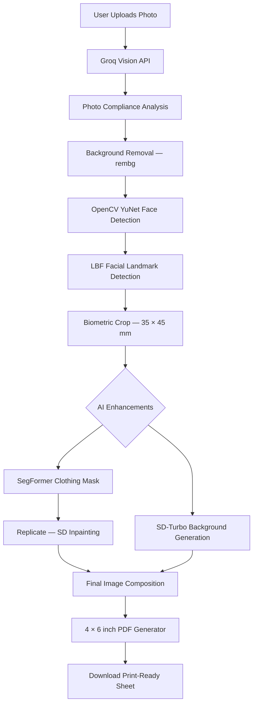

# 📸 AI Passport Studio — Gen AI Photo Booth

An advanced AI-powered photo booth that transforms casual selfies into passport-style photos using **Computer Vision, Generative AI, and automated PDF generation**.

The pipeline combines facial landmark detection for biometric framing, AI-powered image enhancement, background synthesis, and professional clothing inpainting to create print-ready passport photo sheets.

<p align="center">
  
  
  
  
  
  
</p>

---

## ✨ Key Features

- **📐 Biometric Face Cropping:** Uses OpenCV's YuNet face detector and LBF facial landmark detection to identify facial features and calculate consistent portrait framing.
- **🤖 AI Photo Compliance Analysis:** Integrates a vision-capable Groq-hosted model to flag potential issues such as poor lighting, smiling, or glasses.
- **👔 Generative Suit-Up:** Uses SegFormer-based clothing segmentation and Stable Diffusion inpainting through Replicate to transform casual clothing into professional attire.
- **🌄 AI-Generated Backgrounds:** Uses Stable Diffusion Turbo through Hugging Face Diffusers to create professional background options.
- **✂️ Automatic Background Removal:** Uses `rembg` to separate the subject from the original background.
- **🖨️ Print-Ready PDF Generation:** Creates a 4 × 6 inch photo sheet containing six passport-style photos, with crop marks for easier printing.
- **⚙️ Automatic Model Setup:** Downloads the required model files and weights when configured to do so by the application.
- **🧩 Modular Architecture:** Separates image processing, clothing inpainting, background generation, configuration, and PDF generation into dedicated modules.

> **Important:** The application can help prepare passport-style photographs, but its output is not guaranteed to meet every country's official passport or visa requirements. Always verify the required dimensions, head size, background, expression, and other rules before submitting a photo.

## 🏗️ Architecture & Pipeline Flow

The application follows a multi-stage pipeline with separate components for compliance analysis, biometric processing, optional generative enhancements, and final document generation.



### 🔄 How It Works

1. **Upload:** The user uploads a selfie through the Streamlit interface.
2. **Analyze:** The vision model checks for potential photo-quality and compliance issues.
3. **Remove Background:** `rembg` extracts the subject from the original image.
4. **Detect Facial Features:** YuNet detects the face, and LBF estimates facial landmarks.
5. **Crop and Align:** The image processor calculates the crop for the target portrait dimensions.
6. **Enhance:** Optional generative AI components replace clothing or generate a professional background.
7. **Compose:** The subject and background are combined into the final portrait.
8. **Generate PDF:** ReportLab arranges six images on a 4 × 6 inch sheet for printing.

## 🧠 Engineering Challenges Solved

### 1. Facial Landmark Detection Failures

Facial landmark detection may fail when a face is tilted, partially obscured, or poorly lit.

The image-processing pipeline can use validation checks and a fallback centering strategy when landmark detection fails.

**Implementation consideration:** The LBF model commonly returns 68 facial landmarks. Validate the actual output shape and landmark confidence before relying on a fixed landmark count.

### 2. Stable Diffusion Image Dimensions

Many diffusion pipelines work best with image dimensions divisible by 8.

The background generator can adjust input dimensions to valid sizes, generate the background, and resize the result to the intended portrait aspect ratio.

### 3. Model Downloads and Local Resources

The application may need to download ONNX models, landmark files, and diffusion model weights on first use.

Caching downloaded assets and checking whether files already exist can reduce repeated downloads and improve startup performance.

### 4. Combining Multiple AI Components

The pipeline combines local computer vision, locally executed generative models, and external inference APIs.

Keeping each component in a separate module makes it easier to troubleshoot failures, replace models, and introduce alternative implementations.

<p align="center">
  <a href="https://github.com/user-attachments/assets/603abc33-f62e-4d88-a401-51a8bfccd1db">
    <strong>▶️ Watch the Ai Passport Studio
</strong>
  </a>
</p>


## 🛠️ Tech Stack

| Category | Technology | Purpose |
|---|---|---|
| Frontend | Streamlit | Interactive web interface |
| Language | Python | Core application logic |
| Computer Vision | OpenCV | Face detection and image processing |
| Face Detection | YuNet | Face localization |
| Facial Landmarks | LBF | Facial feature estimation |
| Image Segmentation | SegFormer | Clothing segmentation |
| Local Generative AI | Hugging Face Diffusers | Background generation |
| Image Inpainting | Replicate API | AI-assisted clothing replacement |
| Vision Analysis | Groq API | Photo-quality analysis |
| Background Removal | `rembg` | Subject extraction |
| Image Manipulation | Pillow, NumPy | Image composition and transformations |
| PDF Generation | ReportLab | Print-ready photo sheets |
| Configuration | `python-dotenv` | Environment variable management |

## 🚀 Getting Started

Follow these steps to run the application locally.

### Prerequisites

- Python 3.10 or a compatible version supported by your dependencies.
- Git.
- A Groq API key.
- A Replicate API token.
- Sufficient disk space and RAM for the selected AI models.

A compatible GPU may improve local diffusion performance, but CPU execution can be significantly slower.

### 1. Clone the Repository

Replace `AsyncCoder-10` with your GitHub username.

```bash
git clone https://github.com/AsyncCoder-10/ai-passport-studio.git
cd ai-passport-studio
```

### 2. Create a Virtual Environment

**Windows — Command Prompt**

```bat
python -m venv venv
venv\Scripts\activate
```

**Windows — PowerShell**

```powershell
python -m venv venv
.\venv\Scripts\Activate.ps1
```

**macOS / Linux**

```bash
python3 -m venv venv
source venv/bin/activate
```

### 3. Install Dependencies

```bash
python -m pip install --upgrade pip
pip install -r requirements.txt
```

> **Note:** PyTorch, TorchVision, and Diffusers can require substantial downloads and compatible package versions. Follow the official PyTorch installation instructions if you encounter platform or GPU compatibility issues.

### 4. Configure API Keys

Create a `.env` file in the project root:

```env
GROQ_API_KEY=your_groq_api_key_here
REPLICATE_API_TOKEN=your_replicate_api_token_here
```

Get your credentials from:

- [Groq Console](https://console.groq.com/)
- [Replicate](https://replicate.com/)

**Security:** Never commit your `.env` file, API tokens, or other private credentials to GitHub.

### 5. Run the Application

```bash
streamlit run app.py
```

Open the application in your browser:

**http://localhost:8501**

On the first run, the application may download the configured face-detection, landmark-detection, and diffusion model files. Download size and startup time depend on the models selected in your implementation.

## 📁 Project Structure

```text
ai-passport-studio/
│
├── app.py                      # Streamlit UI and orchestration
├── .env                        # API credentials (Git ignored)
├── .gitignore                  # Git ignore rules
├── requirements.txt            # Python dependencies
├── README.md                   # Project documentation
│
├── models/                     # Optional cached model files
│
├── outputs/                    # Generated images and PDF files
│
└── src/
    ├── config.py               # Environment configuration
    ├── image_processor.py      # Face detection, landmarks, and cropping
    ├── clothing_inpaint.py     # Clothing segmentation and inpainting
    ├── background_generator.py # AI background generation
    └── pdf_generator.py        # Print-ready PDF creation
```

> The `models/` and `outputs/` directories are illustrative. Keep them only if your implementation uses them, and follow your actual application's file paths.

## ⚙️ Configuration & Customization

The following settings can be customized in the relevant source modules:

| Setting | Description |
|---|---|
| Portrait dimensions | Target photo size, such as 35 × 45 mm |
| Photo sheet | Paper dimensions, such as 4 × 6 inches |
| Number of copies | Number of photos placed on each sheet |
| Face crop margins | Space around the detected face |
| Background prompt | Description of the desired background |
| Inpainting prompt | Description of professional clothing |
| Model selection | Local diffusion and API-hosted model configuration |
| Output format | Final image and PDF formats |

The actual settings and supported options depend on how the application is implemented.

## 🔮 Future Roadmap

- [ ] **Face Restoration:** Explore CodeFormer or GFPGAN for improving suitable low-quality input images while preserving identity.
- [ ] **Smart Background Suggestions:** Use vision-model analysis to suggest appropriate background prompts.
- [ ] **Docker Support:** Package dependencies and application configuration in a reproducible environment.
- [ ] **Country-Specific Presets:** Add configurable photo dimensions and requirements for different passport and visa applications.
- [ ] **Image Quality Validation:** Check sharpness, exposure, face positioning, and background uniformity.
- [ ] **Batch Processing:** Process multiple photos in one session.
- [ ] **Automated Testing:** Add tests for crop calculations, image dimensions, and PDF layout.
- [ ] **Deployment:** Prepare a secure cloud deployment with resource-aware model loading.

## 🔐 Privacy & Security

- Keep API credentials in environment variables.
- Avoid committing personal photographs, generated identity photos, or private documents.
- Review the privacy policies and data-handling terms of any external inference service before sending images.
- Provide clear user consent and explain when images are sent to external APIs.
- Avoid claiming official biometric compliance without validating the output against the relevant authority's published requirements.

## 🤝 Contributing

Contributions and suggestions are welcome.

1. Fork the repository.
2. Create a feature branch.
3. Implement and test your changes.
4. Submit a pull request with a description of the improvements.

## 📄 License

Choose an appropriate open-source license, such as the MIT License, and add the corresponding `LICENSE` file before distributing the project.

---

<p align="center">
  <strong>Built with Python, OpenCV, Streamlit, Hugging Face, Groq, and Replicate.</strong>
</p>

<p align="center">
  ⭐ If you find this project useful, consider giving the repository a star!
</p>
